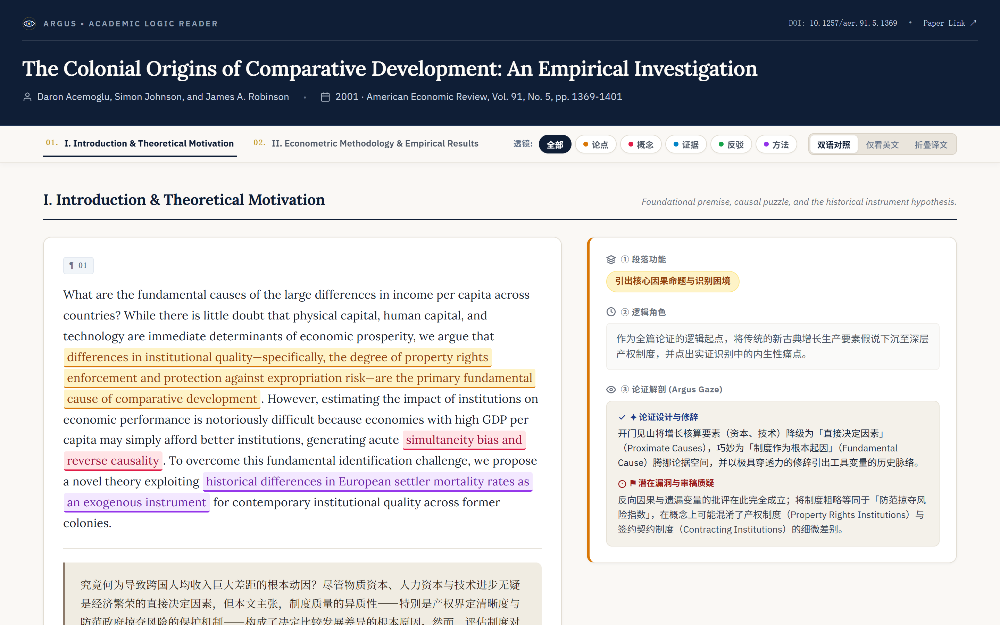
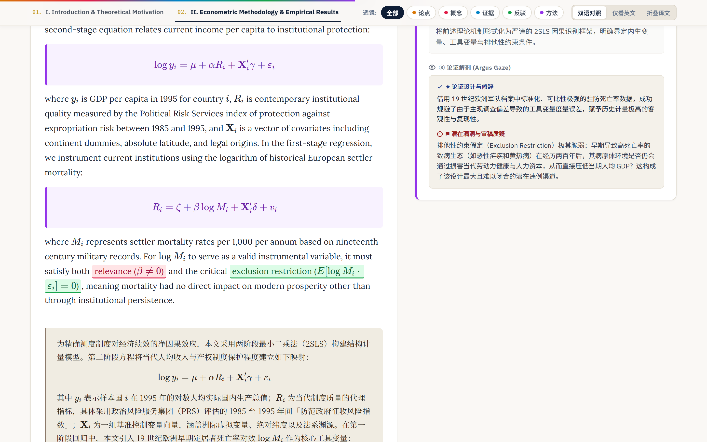
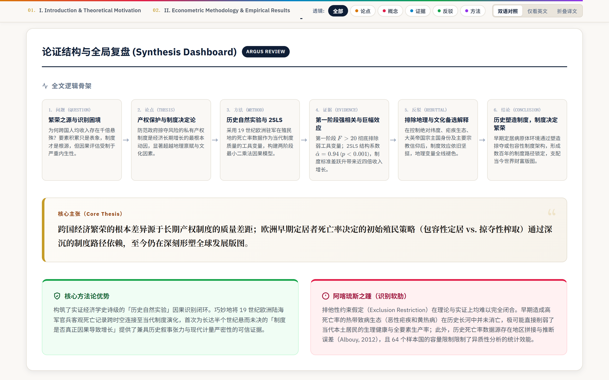

<div align="center">


<h1><a href="https://github.com/lryorb/Argus-paper-reader">Argus-paper-reader</a></h1>

<p>
  <strong>The All-Seeing Academic Paper Logic Deconstructor &amp; Bilingual HTML Annotator</strong>
</p>

<p>
  Works seamlessly with <strong>Google Antigravity</strong>, <strong>Claude Code</strong>, <strong>OpenAI Codex</strong>, <strong>Cursor</strong>, and any Agentic IDE
</p>

<p>
  <sub><em>Named after Argus Panoptes (the hundred-eyed giant) — transforming linear PDF reading into spatial argument mapping</em></sub>
</p>

<p>
  <a href="https://lryorb.github.io/Argus-paper-reader/examples/argus_demo_paper.html">
    
  </a>
  <a href="#quick-start">
    
  </a>
  <a href="./LICENSE-MIT">
    
  </a>
  <a href="./LICENSE-CC0">
    
  </a>
  <a href="https://katex.org/">
    
  </a>
  <a href="./CONTRIBUTING.md">
    
  </a>
</p>

<p>
  <a href="#live-demo"><u>🌐 Live Demo</u></a> &nbsp;•&nbsp;
  <a href="#five-lens-system"><u>👁️ Five-Lens System</u></a> &nbsp;•&nbsp;
  <a href="#quick-start"><u>⚡ Quick Start</u></a> &nbsp;•&nbsp;
  <a href="#architecture"><u>📐 Architecture</u></a> &nbsp;•&nbsp;
  <a href="#prompt-standalone"><u>📖 Prompt Standalone</u></a> &nbsp;•&nbsp;
  <a href="#contributing"><u>🤝 Contributing</u></a>
</p>

<p>
  <code>🏛️ Editorial Masthead Design (AER / Economist Style)</code> &nbsp;·&nbsp;
  <code>🔬 5-Dimension Interactive Spotlight (Keys 0-5)</code> &nbsp;·&nbsp;
  <code>📐 Paragraph-Pair Grid Alignment</code>
  <br />
  <code>🧮 Native KaTeX Block Formula Highlighting</code> &nbsp;·&nbsp;
  <code>🔄 3-Mode Bilingual Switcher</code> &nbsp;·&nbsp;
  <code>🧭 Referee-Grade Vulnerability Analysis</code>
</p>

</div>

---

<a id="live-demo"></a>

<div align="center">

<h3>🏛️ Live Editorial Showcase — Acemoglu, Johnson &amp; Robinson (AER, 2001)</h3>
<p>
  <sub>单文件零依赖交互式 HTML 输出实景 · Zero-Dependency Self-Contained Interactive HTML Output &nbsp;|&nbsp; <a href="https://lryorb.github.io/Argus-paper-reader/examples/argus_demo_paper.html"><strong>Open Interactive Demo ↗</strong></a> · <a href="./examples/argus_demo_paper.html">Download Local HTML</a></sub>
</p>

<p>
  
</p>
<p>
  <sub><strong>Masthead &amp; Dual-Column Grid:</strong> Journal Masthead (Deep Navy &amp; Gold Editorial Header) + Unified Glass Sticky Toolbar + Strictly Aligned Paragraph Grid (¶ 01 English Highlight &amp; Chinese Academic Prose ↔ Three-Tier Referee Card)</sub>
</p>

<br />

<p>
  
</p>
<p>
  <sub><strong>KaTeX Block Formula &amp; Referee Gaze (¶ 03):</strong> Math-protected <code>.hl-block</code> Methodological Equations (<code>\mathbf{X}_i'</code> intact) + Relevance / Exclusion Restriction Lenses ↔ Method Identification Critique</sub>
</p>

<br />

<p>
  
</p>
<p>
  <sub><strong>Synthesis Dashboard:</strong> 6-Stage Logic Skeleton (<code>Question → Thesis → Method → Evidence → Rebuttal → Conclusion</code>) + Core Thesis Banner + Methodological Strength vs. Critical Achilles' Heel</sub>
</p>

</div>

---

<a id="why-argus"></a>

## ✨ Why Argus-paper-reader?

> In Greek mythology, **Argus Panoptes** was the hundred-eyed giant — closing only a few eyes to sleep while keeping the rest open in ceaseless vigilance.
> **Argus-paper-reader** brings that same relentless scrutiny to academic reading: instead of reducing a paper to a flat, generic summary, it projects original prose, publication-grade Chinese translation, structural argument lenses, and referee-level critique onto a unified spatial canvas.

| Dimension / 维度 | Traditional PDF + Generic AI Summary<br/>传统 PDF 阅读 + 普通 AI 摘要 | Argus-paper-reader<br/> |
| :--- | :--- | :--- |
| **Alignment / 段落对齐** | Flat wall of summary bullets detached from original sentences<br/>摘要与原文割裂，难以定位论证出处 | **1:1 `.para-row` CSS Grid**: Every paragraph pairs verbatim English, academic Chinese, and structural critique side-by-side<br/>逐自然段空间网格锁死，一比一对照 |
| **Highlighting / 高亮过滤** | Monochrome yellow highlight clutter with no semantic filtering<br/>单色荧光笔涂鸦，无法按逻辑维度筛选 | **Argus Five-Lens Cross-Column Spotlight**: Instant filtering &amp; dimming across 5 epistemic dimensions via buttons or keys `0–5`<br/>五维透镜跨栏联动 + 键盘 `0–5` 瞬时聚光 |
| **Math &amp; Notation / 公式保真** | Markdown/regex breaks `\mathbf{X}_i'` transposes and displays raw LaTeX<br/>正则替换误伤矩阵转置符号，公式渲染错乱 | **Math-Protected Sanitizer + KaTeX `.hl-block`**: Extracts &amp; shields `$$...$$` / `$...$` blocks before punctuation normalization; upgrades highlighted equations into framed cards<br/>数学块占位隔离 + 原生 KaTeX 块级公式卡片 |
| **Critical Depth / 批判深度** | Passive paraphrasing that repeats the author's claims uncritically<br/>只会顺着作者复述，缺乏审稿人质疑视角 | **Three-Tier Referee Commentary (`Argus Gaze`)**: Dissects rhetorical framing *and* exposes identification vulnerabilities (weak IV, exclusion violations, omitted bias)<br/>三层批注直击因果识别软肋与审稿致命提问 |
| **Portability / 部署与分享** | Locked inside proprietary web apps or SaaS subscriptions<br/>依赖特定在线服务，导出格式破碎 | **Zero-Dependency Self-Contained HTML5**: Pure Python stdlib compiler outputs a single `.html` file ready for group meetings, Notion embeds, or offline reading<br/>纯标准库编译为单文件 `.html`，永久本地存档与组会汇报 |

---

<a id="five-lens-system"></a>

## 👁️ The Argus Five-Lens System | 五维透镜体系

Press number keys **`0`–`5`** or click the glass toolbar pills to illuminate one analytical dimension across **both** the English text (`<mark>`) and the right-hand referee cards (`data-dominant`):

| Key | Lens / 维度 | Swatch / 色彩规范 | Epistemic Role / 学术判定标准 | Canonical Signal Phrases / 典型信号特征 |
| :---: | :--- | :--- | :--- | :--- |
| **`0`** | **All Lenses**<br/>全部视角 |  | Restores full multi-chromatic highlighting across all paragraphs | Default inspection mode (`Esc` or `0`) |
| **`1`** | **Thesis**<br/>核心论点 |  | Central hypotheses, main causal claims, overarching theoretical contributions | *we hypothesize*, *the central result is*, *this paper demonstrates* |
| **`2`** | **Concept**<br/>关键概念 |  | Theoretical constructs, operationalized variables, mechanisms, indices | *we define*, *settler mortality*, *expropriation risk index* |
| **`3`** | **Evidence**<br/>实证证据 |  | Point estimates, $t$-stats / $p$-values, first-stage $F$-stats, baseline facts | *coefficient of 0.94*, *$F > 20$*, *statistically significant at 1%* |
| **`4`** | **Rebuttal**<br/>让步反驳 |  | Explicit concessions, ruling out alternative hypotheses, scope boundaries | *one might worry that*, *robust to controlling for*, *cannot rule out* |
| **`5`** | **Method**<br/>方法论 |  | Identification strategies (`2SLS`, `DID`, `RDD`, `DML`), estimating equations, sampling | *exclusion restriction*, *two-stage least squares*, `$$\log y_i = \dots$$` |

> **3-Mode Bilingual Switcher (三模式阅读切换)**: Toggle instantly between **Bilingual (`双语对照`)**, **English Only (`仅英文`)**, and **Collapsible Chinese (`折叠译文`)** — where every paragraph's Chinese block collapses cleanly behind an accessible click target (`▸ 展开中文译文`).

---

<a id="three-tier-commentary"></a>

## 🧠 Three-Tier Referee Commentary | 右栏三层审稿人批注解剖

Every paragraph `.para-row` pairs the bilingual left column with a structured analytical card on the right column, enforcing three rigorous tiers of academic scrutiny:

```text
┌────────────────────────────────────────────────────────────────────────────┐
│  ¶ 03  ·  [ 识别策略与两阶段计量设定 ]                 Dominant: [Method]    │
├────────────────────────────────────────────────────────────────────────────┤
│  ① Paragraph Function (段落功能)                                            │
│     Concise pill badge categorizing structural purpose in the manuscript.  │
│                                                                            │
│  ② Logical Role (逻辑角色)                                                  │
│     Explains how the paragraph bridges prior assumptions to empirical tests│
│     and advances the global argument skeleton.                             │
│                                                                            │
│  ③ Argus Gaze (论证解剖与审稿人透视)                                         │
│     ├─ ✦ Argument Design & Rhetoric (论证设计与修辞)                        │
│     │    Why the author orders intuition, notation, or robustness tests.   │
│     └─ ⚑ Potential Vulnerability & Referee Critique (潜在漏洞与审稿质疑)    │
│          Sharp counterfactual challenge (omitted variables, measurement    │
│          error propagation, weak IV, external validity, SUTVA violations). │
└────────────────────────────────────────────────────────────────────────────┘
```

At the bottom of the document, the **Synthesis Dashboard (`全局逻辑复盘仪表盘`)** compresses the entire paper into:
1. **Core Thesis Banner (`核心学术主张`)**: Single high-density causal proposition.
2. **6-Stage Logic Skeleton (`全文六步论证骨架`)**: `Question` → `Thesis` → `Method` → `Evidence` → `Rebuttal` → `Conclusion`.
3. **Asymmetric Balance Sheet**: **Core Methodological Strength (`论证最强处`)** vs. **Critical Achilles' Heel (`阿喀琉斯之踵 / 识别软肋`)**.

---

<a id="quick-start"></a>

## ⚡ Quick Start & Installation | 多平台一键安装指南

### Option A · Install as an Agent Skill

#### 1. Google Antigravity
Clone directly into your workspace (project-scoped) or global Antigravity skills directory:
```bash
# Project-level (recommended for paper-reading workspaces)
git clone https://github.com/lryorb/Argus-paper-reader.git /tmp/argus-skill && \
mkdir -p .agents/skills && \
cp -r /tmp/argus-skill/.agents/skills/argus-paper-reader .agents/skills/

# Global Antigravity installation (Windows PowerShell)
git clone https://github.com/lryorb/Argus-paper-reader.git $env:TEMP\argus-skill
New-Item -ItemType Directory -Force -Path "$env:USERPROFILE\.gemini\antigravity\skills"
Copy-Item -Recurse "$env:TEMP\argus-skill\.agents\skills\argus-paper-reader" "$env:USERPROFILE\.gemini\antigravity\skills\"
```

#### 2. Claude Code
```bash
# Project-level (.claude/skills/) or global (~/.claude/skills/)
mkdir -p ~/.claude/skills && \
git clone --depth 1 https://github.com/lryorb/Argus-paper-reader.git /tmp/argus-skill && \
cp -r /tmp/argus-skill/.agents/skills/argus-paper-reader ~/.claude/skills/argus-paper-reader
```

#### 3. OpenAI Codex CLI / Cursor
```bash
# Codex / Cursor universal .agents/skills convention
mkdir -p .agents/skills && \
git clone --depth 1 https://github.com/lryorb/Argus-paper-reader.git /tmp/argus-skill && \
cp -r /tmp/argus-skill/.agents/skills/argus-paper-reader .agents/skills/argus-paper-reader
```

### Option B · Trigger in Chat
Once installed, drop a PDF, LaTeX source, or pasted paper text and ask:
- *"Use `argus-paper-reader` to dissect this paper into a bilingual dual-column HTML logic reader."*
- *"请用 Argus 精读这篇实证论文，拆解其因果识别骨架并生成双栏 HTML 页面。"*

### Option C · Run the Zero-Dependency Python Builder Directly
Reproduce or compile your own structured JSON payload into a single self-contained `.html` file (requires **Python 3.8+**, zero `pip install` needed):

```bash
python3 .agents/skills/argus-paper-reader/scripts/build_html.py \
  --input examples/demo_data.json \
  --output examples/argus_demo_paper.html
```

---

<a id="prompt-standalone"></a>

## 📖 Prompt Standalone | 零配置网页版 AI 独立 Prompt

No CLI or Agent IDE? Expand and paste the prompt below directly into **Claude**, **ChatGPT**, or **Gemini** alongside any paper excerpt to generate valid **Argus JSON** or standalone HTML:

<details>
<summary><strong>📋 Click to expand copy-paste Standalone Argus Prompt (点击展开完整独立精读 Prompt)</strong></summary>

```markdown
You are **Argus Panoptes (The Hundred-Eyed Referee)** — an elite empirical economist, statistician, and peer reviewer. Deconstruct the academic paper below into a structured JSON object compatible with `argus-paper-reader` (or directly render an editorial dual-column bilingual HTML page).

### Strict Analytical Rules
1. **1:1 Paragraph Fidelity**: NEVER merge, skip, or summarize away paragraphs. Every original paragraph becomes one entry in `sections[].paragraphs[]` with preserved KaTeX notation (`$...$` inline, `$$...$$` display).
2. **Argus Five-Lens Highlighting (English Prose)**: Inject semantic `<mark>` tags inside `en`:
   - `thesis` (Central hypotheses / causal claims): `<mark class="hl hl-thesis" data-dim="thesis" data-label="核心论点">...</mark>`
   - `concept` (Key constructs / variables): `<mark class="hl hl-concept" data-dim="concept" data-label="关键概念">...</mark>`
   - `evidence` (Coefficients / F-stats / p-values): `<mark class="hl hl-evidence" data-dim="evidence" data-label="实证证据">...</mark>`
   - `rebuttal` (Concessions / exclusions): `<mark class="hl hl-rebuttal" data-dim="rebuttal" data-label="让步反驳">...</mark>`
   - `method` (Identification / equations): `<mark class="hl hl-method" data-dim="method" data-label="识别方法">...</mark>`
   Note: When highlighting display math `$$...$$`, wrap cleanly in `<mark class="hl hl-method" ...>$$...$$</mark>`.
3. **Publication-Grade Chinese Translation (`zh`)**:
   - Match the scholarly register of *Economic Research Journal* (《经济研究》) or *Management World* (《管理世界》).
   - Use Chinese corner brackets `「...」` or double quotes `“...”` for specialized concepts and paper titles; NEVER convert ASCII apostrophes or LaTeX transpose operators (`\mathbf{X}_i'`).
4. **Three-Tier Referee Commentary (`annotation`)** per paragraph:
   - `function`: Concise structural badge (e.g., `识别策略与两阶段设定`).
   - `logical_role`: Exact narrative bridge connecting prior and subsequent claims.
   - `gaze.technique`: Why the author designed the framing/equation this way.
   - `gaze.vulnerability`: Ruthless peer-reviewer critique (weak IV, exclusion restriction threats, omitted variables, measurement error, external validity).
5. **Global Synthesis Dashboard (`synthesis`)**:
   - `core_thesis`: One-sentence core causal claim.
   - `logic_skeleton`: Exactly 6 ordered steps (`Question`, `Thesis`, `Method`, `Evidence`, `Rebuttal`, `Conclusion`).
   - `strength` & `achilles_heel`: Balanced methodological evaluation.

### Required JSON Output Schema
{
  "meta": { "title": "", "authors": "", "year": "", "venue": "", "doi": "", "url": "" },
  "sections": [
    {
      "id": "sec-1",
      "title": "",
      "desc": "",
      "paragraphs": [
        {
          "index": 1,
          "dominant_dimension": "thesis | concept | evidence | rebuttal | method",
          "en": "",
          "zh": "",
          "annotation": {
            "function": "",
            "logical_role": "",
            "gaze": { "technique": "", "vulnerability": "" }
          }
        }
      ]
    }
  ],
  "synthesis": {
    "core_thesis": "",
    "logic_skeleton": [
      { "step": "问题 (Question)", "title": "", "desc": "" },
      { "step": "论点 (Thesis)", "title": "", "desc": "" },
      { "step": "方法 (Method)", "title": "", "desc": "" },
      { "step": "证据 (Evidence)", "title": "", "desc": "" },
      { "step": "反驳 (Rebuttal)", "title": "", "desc": "" },
      { "step": "结论 (Conclusion)", "title": "", "desc": "" }
    ],
    "strength": { "title": "", "content": "" },
    "achilles_heel": { "title": "", "content": "" }
  }
}
```

</details>

---

<a id="architecture"></a>

## 📐 Architecture & Repository Structure | 工程架构与目录树

```text
Argus-paper-reader/
├── .agents/skills/argus-paper-reader/
│   ├── SKILL.md                        # Core Skill manifest & execution workflow
│   ├── resources/
│   │   ├── annotation-rubric.md        # Five-Lens criteria, translation style, referee checklist
│   │   └── template.html               # Self-contained HTML5 + Editorial CSS + Cross-Column JS
│   └── scripts/
│       └── build_html.py               # Stdlib-only builder (Math-shielded sanitizer & JSON injector)
├── assets/
│   ├── argus-logo.svg                  # Deep Navy & Gold geometric Argus Panoptes emblem
│   ├── hero-preview.png                # 1440×900 high-DPI screenshot of Masthead & ¶ 01 grid
│   ├── formula-preview.png             # 1440×900 high-DPI screenshot of ¶ 03 KaTeX .hl-block equations
│   └── dashboard-preview.png           # 1440×900 high-DPI screenshot of 6-step Synthesis Dashboard
├── examples/
│   ├── demo_data.json                  # Structured AJR (2001) excerpt dataset
│   └── argus_demo_paper.html           # Compiled interactive live demo page
├── README.md                           # Flagship project documentation (you are here)
├── CONTRIBUTING.md                     # Bug report guide, rubric extensions & theme PR workflow
├── SECURITY.md                         # Offline HTML architecture, SRI pins & XSS hardening policy
├── CODE_OF_CONDUCT.md                  # Contributor Covenant v2.1
├── LICENSE                             # Dual-License architectural overview (Custom License tab)
├── LICENSE-MIT                         # MIT License (code, templates & scripts)
├── LICENSE-CC0                         # CC0 1.0 Universal (rubrics, schemas & outputs)
└── .gitignore
```

### Build Pipeline Highlights
1. **JSON Contract & Rubric Validation**: Structures extracted paragraphs and 3-tier referee notes without losing sentence-level correspondence.
2. **Math-Protected Punctuation Sanitizer (`normalize_zh_punctuation`)**: Temporarily replaces `$$...$$`, `$...$`, `\[...\]`, `\( ... \)`, and HTML `<...>` tags with opaque tokens before converting typographic quotes (`‘...’` → `「...」`), ensuring LaTeX transpose operators (`\mathbf{X}_i'`) are never corrupted.
3. **XSS-Hardened Inline Archive**: Escapes `</` into `<\/` before embedding `#argus-raw-data` JSON inside the HTML, enabling downstream re-export or programmatic inspection.
4. **Cross-Column Spotlight Engine**: Clicking any lens (or pressing `0–5`) simultaneously isolates matching `<mark data-dim="...">` spans on the left, spotlights matching `.annotation-card[data-dominant="..."]` cards on the right, and softly dims non-matching rows.

---

## 🎓 Built for Empirical & Theoretical Research | 适用学科场景

| Research Domain / 学科领域 | Signature Argus Capabilities / 核心赋能点 |
| :--- | :--- |
| **Applied Econometrics & Causal Inference**<br/>应用计量经济学与因果推断 | Evaluates `2SLS / IV` exclusion restrictions, `DID` parallel-trends assumptions, `RDD` bandwidth sensitivity, `DML` Neyman orthogonality, and measurement-error attenuation in `Argus Gaze`. |
| **Statistics & Biostatistics**<br/>统计学与生物统计 | Preserves multi-line estimators, asymptotic variance expressions, and identification theorems via KaTeX `.hl-block` cards while auditing regularity conditions. |
| **CS / AI / ML Top Conferences**<br/>人工智能与计算机顶会 (`NeurIPS`, `ICML`, `ACL`) | Separates problem formulation (`Concept`), loss design & architecture (`Method`), ablation gains (`Evidence`), and failure-case acknowledgments (`Rebuttal`) for rapid group-meeting critique. |
| **PhD Qualifying Exams & Peer Review**<br/>博士资格考精读与同行审稿演练 | Generates printable/exportable reading dossiers exposing every paper's 6-step logical spine and its *Achilles' Heel*. |

---

<a id="contributing"></a>

## 🤝 Contributing & Security | 参与贡献与安全机制

Contributions of all kinds — LaTeX edge-case fixes, domain-specific Five-Lens extensions (e.g., clinical trials, NLP benchmarks, macro DSGE), new typography themes, and paper showcase examples — are warmly welcomed!

- Read our **[Contributing Guidelines](./CONTRIBUTING.md)** for the Fork → Branch → PR workflow and local build verification steps.
- Review our **[Security Policy](./SECURITY.md)** covering SRI-pinned CDN dependencies (`KaTeX v0.16.9`, Google Fonts), static single-file isolation, and vulnerability disclosure.
- Please adhere to our **[Code of Conduct](./CODE_OF_CONDUCT.md)**.

---

## ⚖️ Dual License | 双开源协议架构

**Argus-paper-reader** uses a thoughtful **Dual-License Model** modeled after leading open-source AI communities:

| Scope / 适用范围 | License / 授权协议 | Full Text / 协议文件 |
| :--- | :--- | :--- |
| Scripts (`build_html.py`), HTML/CSS/JS Viewer (`template.html`), Skill Scaffolding | **MIT License** | [`LICENSE-MIT`](./LICENSE-MIT) |
| Annotation Rubric (`annotation-rubric.md`), JSON Schemas, Prompts, &amp; **Generated HTML Outputs** | **CC0 1.0 Universal (Public Domain)** | [`LICENSE-CC0`](./LICENSE-CC0) |
| Architecture Summary &amp; Default Policy | **Dual-License Overview** | [`LICENSE`](./LICENSE) |

> Academics, graduate students, and research labs may freely include, adapt, share, and publish generated bilingual HTML reading notes in seminars, courses, or public repositories with zero attribution friction under **CC0-1.0**.

---

## ⭐ Star History

<div align="center">

<a href="https://www.star-history.com/#lryorb/Argus-paper-reader&Date">
  <picture>
    <source media="(prefers-color-scheme: dark)" srcset="https://api.star-history.com/svg?repos=lryorb/Argus-paper-reader&type=Date&theme=dark" />
    <source media="(prefers-color-scheme: light)" srcset="https://api.star-history.com/svg?repos=lryorb/Argus-paper-reader&type=Date" />
    
  </picture>
</a>

<br />
<p><sub>If Argus sharpens your paper reading or saves hours during literature review and peer review, consider giving it a ⭐!</sub></p>

</div>
